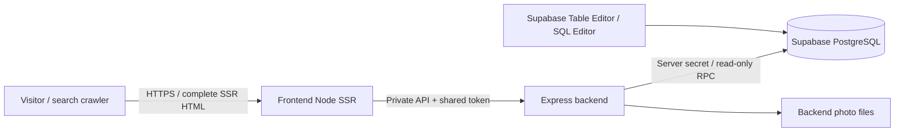

# Deploying RoniElla Tours

**For the selected Vercel hosting setup, use the [two-project Vercel guide](vercel-deployment.md).**
It supersedes the Docker-specific hosting steps below. On Vercel, photos are
backend static assets rather than files inside the API function. The schema,
content editing, migration and backup guidance below still applies. The user has
now applied the initial schema and seed to Supabase; do not repeat that seed.

This checkout now contains the three deployment pieces: a React/Vite Node SSR frontend, an Express backend, and a Supabase PostgreSQL content schema. **Nothing has been deployed or provisioned.** You run the hosted commands below when ready.

The hosting package is portable Docker, so the frontend and backend can run as two managed container services or together on a server using Compose. Supabase hosts the database. An optional Caddy configuration supplies HTTPS when you manage the server yourself.



## What goes where

| Pillar | Deployment artifact | Responsibility |
| --- | --- | --- |
| Frontend | `Dockerfile` target `frontend` | React Router SSR, routes, metadata/canonicals, robots/sitemap, same-origin photo delivery |
| Backend | `Dockerfile` target `backend` | Validate content, read Supabase, cache for 30 seconds, authorize frontend requests, serve registered photos |
| Database | `supabase/migrations/*.sql` then `supabase/seed.sql` | Editable page text, ordered blocks, placement copy, navigation, redirects and media references |

Photos are **files in the backend image**, not database blobs or frontend assets. The current backend contains the existing editorial images and 123 album photos. Supabase stores their paths, sizes, alt text and album membership. New photo bytes require a backend release; text edits do not. This is an intentional first deployment arrangement that works with the current backend. External object storage can be added later at the existing media boundary.

## Database organization

There are 13 content tables. Ordinary text has ordinary text columns; JSON is limited to structured lists, table cells, links and legacy query parameters.

| Table | What you edit / relationship |
| --- | --- |
| `content_site` | One site row: business name, contact information, notice and provenance |
| `content_pages` | One page/tour/article: stable URL, page type, title, optional display title, SEO title/description, hero reference and `published` |
| `content_blocks` | Page body: `page_id` + `position` specify where the paragraph/heading/list/table appears; edit `text` for paragraphs/headings |
| `content_copy` | Display slots: `area=home.hero`, `slot=heading`, `value=…`; also introduction, principles, destination, shared contact/footer copy |
| `content_navigation` | Header/footer labels and page references in order |
| `content_featured` | Ordered featured tours/articles |
| `content_page_cards` | Listing/related-page links and summary text |
| `content_redirects` | Existing path/query aliases, pointing to stable page IDs |
| `content_videos` | Page video titles, descriptions and external links |
| `content_media` | Image metadata and backend file URL; `kind` distinguishes editorial and gallery photos |
| `content_media_variants` | Responsive image variants per media ID |
| `content_gallery` | Album URL, gallery introduction/button copy, number displayed and last import time |
| `content_gallery_photos` | Ordered album membership; runtime selection is randomized by the SSR loader |

The initial seed contains **40 published pages, 1,211 body blocks, 49 copy slots, 72 redirects and 123 gallery photos**, plus the existing site/media/navigation records. It is generated from the current JSON content, preserving every text block, ID, order, canonical path and reference. A PostgreSQL round-trip test compares the complete result with the filesystem source.

New `content_pages` rows default to `published=false`. Only published pages appear in the public response; cards, navigation, featured links and redirects to draft pages are filtered out. A published homepage remains required. `/health/` and `/media/…` are reserved application paths.

The original `contentSource=liveArchive` value describes where the text came from; it does not mean the online app reads archive files. `CONTENT_PROVIDER` selects actual storage.

## 1. Validate the checkout locally

From `D:\repos\RoniEllaToursWebsite\rebuild` (or the corresponding checkout directory):

```powershell
npm.cmd ci
npm.cmd run check:deployment
```

On Linux/macOS use `npm` and `npx` instead of `npm.cmd` and `npx.cmd`. Node 24 / npm 11 are required. The lockfile pins dependencies, including Supabase CLI **3.0.0** and the embedded PostgreSQL test engine.

`check:deployment` checks TypeScript including deployment scripts, unit/repository tests, real PostgreSQL migrations/permissions/content import, production client/server builds, and the complete SSR → authenticated API → Supabase adapter → PostgreSQL flow. It uses local test processes and an in-memory database; it does not contact a hosted Supabase project.

To build and exercise the actual containers using local file content:

```powershell
docker compose --env-file deploy/local.env.example -f deploy/compose.yml build
docker compose --env-file deploy/local.env.example -f deploy/compose.yml up -d --wait
```

Open `http://localhost:3000`, `/gallery/`, and `/health`. Stop this local test with:

```powershell
docker compose --env-file deploy/local.env.example -f deploy/compose.yml down
```

The local example uses a deliberately non-production token and filesystem data. The online configuration below uses Supabase. Build stages compile once and copy only runtime artifacts into the final non-root images; the frontend image contains neither backend content nor travel photos. [Docker multi-stage builds](https://docs.docker.com/build/building/multi-stage/).

## 2. Create and populate your Supabase project

Create a Supabase project in your account and record its project reference and HTTPS project URL. Use a fresh project for the initial content import. Keep schema migrations in version control.

The following commands **are for you to run** and do change the selected hosted database. CLI v3 defaults database commands to local; `--remote` explicitly targets the linked project.

```powershell
npx.cmd supabase login
npx.cmd supabase link --project-ref YOUR_PROJECT_REF
npx.cmd supabase db push --remote --dry-run
# First import into the empty content schema only:
npx.cmd supabase db push --remote --include-seed
```

Two migrations create the normalized tables, constraints, permissions, update timestamps and `read_site_content()` function. `--include-seed` imports the prepared content. The seed deliberately refuses to overwrite an existing `content_site` or `content_pages` row and runs inside a transaction. Do not use `--include-seed` for routine releases.

If you prefer manual SQL, run the two migration files in filename order and then `supabase/seed.sql` in the project's SQL Editor. Choose one migration-management approach; do not apply the same migration manually and then blindly push it again through the CLI.

If the local content changed before the first import, regenerate and review the seed with:

```powershell
npm.cmd run db:seed
npm.cmd run db:verify
```

These two commands only generate local SQL and test an ephemeral local database. Supabase migrations and seeds are standard versioned SQL files. [Supabase migration workflow](https://supabase.com/docs/guides/local-development/database-migrations).

Optional full local Supabase stack, when Docker is running: `npx.cmd supabase start`, then `npx.cmd supabase db reset` to recreate **local** schema/content from the checked-in files. Never add `--remote` to a reset as part of a deployment. Stop the local stack with `npx.cmd supabase stop`.

## 3. Supply deployment configuration

Copy `deploy/.env.example` to `deploy/.env`. The filled file and Supabase CLI link state are ignored by Git and excluded from Docker builds. Fill in the actual values; `npm.cmd run deploy:preflight` checks the file offline without printing secrets or contacting any service.

Generate your own backend token locally:

```powershell
node -e "console.log(require('node:crypto').randomBytes(32).toString('hex'))"
```

| Variable | Which service | Value |
| --- | --- | --- |
| `CONTENT_PROVIDER` | Backend | `supabase` online; `files` for the existing local workflow |
| `SUPABASE_URL` | Backend | Your project's HTTPS origin |
| `SUPABASE_SECRET_KEY` | Backend only | A server `sb_secret_…` API key from your Supabase project |
| `BACKEND_API_TOKEN` | Backend + frontend SSR | The same random 64-character token in both |
| `BACKEND_ORIGIN` | Frontend SSR | `http://backend:3001` in Compose; your backend's private/HTTPS origin on other hosts |
| `SITE_ORIGIN` | Frontend SSR | Final public origin, e.g. `https://roniellatours.com`, or a preview origin; no path |
| `DEPLOYMENT_ENV` | Both | `preview` initially; `production` for the public release |
| `ALLOW_INDEXING` | Frontend SSR | `false` for preview; set `true` only on the intended production domain |
| `API_HOST` / `API_PORT` | Backend | `0.0.0.0` / `3001` in the backend image; match the host's configured container port |
| `HOST` / `PORT` | Frontend | `0.0.0.0` / `3000` in the frontend image |
| `CONTENT_CACHE_MS` | Backend | `30000`; database edits appear within this interval, or after backend restart |
| `SUPABASE_TIMEOUT_MS` | Backend | `8000` |
| `CONTENT_TIMEOUT_MS` | Frontend | `12000`; must exceed the database timeout |
| `RELEASE_TAG` | Compose | A version/commit label; use a new tag for each release |
| `SITE_HOST` / `TLS_EMAIL` | Optional Caddy edge | Public hostname matching `SITE_ORIGIN`, and your certificate-contact email |

Supabase secret keys stay on the backend and are sent in the `apikey` header. They are not browser keys or JWT bearer tokens. A legacy `service_role` JWT is also supported for compatible local stacks. [Supabase API key guidance](https://supabase.com/docs/guides/getting-started/api-keys).

All content tables have RLS enabled. `anon`, `authenticated` and `PUBLIC` have no table or RPC grants; `service_role` has SELECT on these tables and execution of the read-only content function. Editing is through your authenticated Supabase dashboard/SQL management tools. There is no public editing endpoint. The key remains privileged elsewhere in Supabase, so use a dedicated server key and do not put it in frontend environment variables or build arguments. [Supabase RLS and privileges](https://supabase.com/docs/guides/database/postgres/row-level-security).

After applying the schema/content and filling `deploy/.env`, you can run a **read-only** connection check:

```powershell
npm.cmd run deploy:preflight
npm.cmd run db:check
```

`db:check` calls your configured database's read RPC, validates its response, and checks that all referenced photo files exist in this checkout. It does not modify any hosted data. No hosted check was run during preparation.

## 4. Deploy the backend and frontend yourself

### Two managed container services

Both builds use **`rebuild/` as the build context** and `rebuild/Dockerfile` as the Dockerfile. Select target `backend` for the API and target `frontend` for the website. A platform supporting only one default Docker target needs two builds with explicit `--target` arguments:

```powershell
docker build --target backend -t roniella-backend:YOUR_RELEASE rebuild
docker build --target frontend -t roniella-frontend:YOUR_RELEASE rebuild
```

Those two commands run from the repository root; when running inside `rebuild`, replace the final `rebuild` argument with `.`. Push/upload the resulting images through your chosen host's normal release flow. No registry or cloud provider has been configured on your behalf.

Deploy the backend first. Set only its environment values, expose container port 3001 privately where supported, and use `/ready` for readiness. Then deploy the frontend with its own values, matching backend token, and `BACKEND_ORIGIN`. Use `/health` as its readiness probe; it checks the full data path. Assign the public domain and HTTPS to the frontend. No static SPA fallback is used: the frontend must run the Node SSR process.

If the host supplies a dynamic port, set the backend's `API_PORT` accordingly or run without the image's fixed API_PORT setting so the standalone server can use `PORT`. The frontend uses `PORT` directly. Configure probes against that same port.

### Compose on your own server

After preparing Supabase and `deploy/.env`, run from `rebuild/`:

```powershell
docker compose --env-file deploy/.env -f deploy/compose.yml config --quiet
docker compose --env-file deploy/.env -f deploy/compose.yml build
docker compose --env-file deploy/.env -f deploy/compose.yml up -d --wait
```

The API has no host-published port. The frontend binds to host loopback port 3000 for an existing reverse proxy. Both app containers run as non-root users with read-only filesystems; photos are bundled into the backend image. Secrets are supplied only at runtime. Compose does not run migrations or seed a database on startup.

For the provided HTTPS edge, set `SITE_HOST`, `TLS_EMAIL`, and matching `SITE_ORIGIN`, then point that hostname's DNS to your server and permit ports 80/443. Start with the additional file:

```powershell
docker compose --env-file deploy/.env -f deploy/compose.yml -f deploy/compose.tls.yml up -d --wait
```

Caddy fronts the SSR service and maintains its certificate data in named volumes. If both apex and `www` names will be used, configure the explicit alias redirect shown in `deploy/Caddyfile` and its DNS before cutover. [Caddy reverse proxy](https://caddyserver.com/docs/caddyfile/directives/reverse_proxy).

## 5. Review the preview and enable production indexing

Verify homepage, tours, an article, contact page, gallery shuffle/enlargement and a legacy URL redirect. Check `/health` returns 200, photos load through `/media/…`, and generated canonical links use your configured public origin.

Preview uses `DEPLOYMENT_ENV=preview`, `ALLOW_INDEXING=false`, `X-Robots-Tag: noindex`, disallow-all robots.txt and an unavailable sitemap. This is indexing protection, not access control; use your host's preview password/auth setting if the preview must be private.

For the final public release set:

```dotenv
DEPLOYMENT_ENV=production
SITE_ORIGIN=https://roniellatours.com
ALLOW_INDEXING=true
```

Restart/release the frontend with these values. `/robots.txt` then permits crawling and references `/sitemap.xml`; the sitemap contains published page canonicals. Origin is configured explicitly, not inferred from an untrusted request Host header. Verify DNS/TLS and any `www` redirect before switching traffic from the current production site.

## Editing and future releases

Text editing examples in Supabase's SQL Editor (or edit the corresponding rows in Table Editor):

```sql
-- Homepage hero: the area and slot identify exactly where the text is used.
update public.content_copy
set value = 'הכותרת החדשה שלכם'
where area = 'home.hero' and slot = 'heading';

-- Locate the ordered body text for one tour before editing a specific row.
select b.position, b.block_type, b.text
from public.content_blocks b
join public.content_pages p on p.id = b.page_id
where p.path = '/tours/china-may-2027/'
order by b.position;
```

Keep placement keys and stable page IDs. Existing tours retain their individual dated pages. `page_type` selects the current React template; adding an unknown type uses the reading template, so creating a new visual template still requires frontend code. `position` values need only be unique within their group; gaps are fine. `content_pages.path` defines the canonical and final slug. For a changed path, add a redirect from the old path to the same page ID. Related links follow page IDs automatically.

Ordinary text edits, metadata changes, publishing a valid new page, and redirects are read at runtime with no frontend rebuild. Invalid references, unsafe links, missing required slots or missing photo files fail validation rather than publishing broken content. Keep public data consistent within a transaction when editing several related rows.

After the initial move, Supabase is the online text source of truth. The local JSON folder is a development/bootstrap copy, not a two-way synchronization mechanism. Do not regenerate and reapply the initial seed over database edits.

For schema changes create a new SQL migration, validate it locally, and apply it with `npx.cmd supabase db push --remote` **without `--include-seed`**. Deploy backward-compatible database changes before the backend, then the frontend. Never migrate automatically from an application container's startup command.

For album changes after moving online:

1. Keep the local `backend/content/gallery.json` album link aligned with the intended database album.
2. Run `npm.cmd run sync:gallery`, then `npm.cmd run db:gallery`.
3. Review `deploy/gallery-update.sql`. It updates only image metadata/membership/import details and preserves existing database gallery prose and photo alt descriptions.
4. Build and deploy the backend containing the new photo files **before** applying the reviewed SQL in Supabase. Keep the previous release's photo files available while cached old metadata expires. Then allow the 30-second content cache to refresh, or restart the backend.

The original Google Photos integration remains an explicit cached import, not an automatic subscription to changes.

## Backups and rollback

Keep the previous frontend/backend image tags. Rolling application code back means selecting those earlier tags and releasing those images; it does not require reimporting the seed or resetting the database. Maintain compatible schema during that rollback window.

Before a schema/content migration, take a project backup or a schema/data dump using your normal Supabase backup process. CLI v3 examples for the linked project:

```powershell
npx.cmd supabase db dump --remote --file deploy/schema.backup.sql
npx.cmd supabase db dump --remote --data-only --file deploy/content.backup.sql
```

The backup paths are Git-ignored. Test restoration in a separate project before relying on a database rollback. Keep backend image artifacts as the corresponding photo backup; the SQL data stores references, not the photo bytes.

## CI and verification boundary

`.github/workflows/deployment-readiness.yml` is at the repository root. On pull requests or manual dispatch it installs locked dependencies, runs deployment checks, builds both Docker targets and starts the two containers locally using file content. It does not log in to Supabase, push images, deploy a hosted service or change DNS. No cloud secrets are needed by this workflow.

Locally verified during preparation:

- TypeScript checks for shared/backend/frontend and maintenance scripts.
- All 28 unit/repository tests.
- Both SQL migrations executed in embedded PostgreSQL; complete seed equality, RLS/grants, draft filtering, safe repeated-import refusal, constraints and gallery updates preserving edited copy.
- Production frontend and backend builds.
- Production SSR through the actual Supabase HTTP adapter, authenticated backend, and an HTTP test bridge to PostgreSQL: all 40 pages, 72 redirects, database text edits/new pages without rebuild, canonical/sitemap/indexing behavior, gallery media, outage/recovery and no secrets in HTML/client bundles.
- Compose configuration validation, including the TLS overlay, and installed Supabase CLI v3 command/flag checks.
- Offline production-environment preflight, all 40 pages in desktop/mobile browser smoke, and the gallery at five viewport widths with hydration/keyboard/no-JavaScript checks.
- Existing desktop/mobile journeys, guide/article/itinerary content, keyboard menus and JavaScript-disabled navigation.

The HTTP bridge tests the application's Supabase request/response contract; it is not the hosted Supabase gateway. Hosted project connectivity, your actual keys, DNS and TLS remain user-side deployment checks. Docker configuration validates here, but the local Docker engine is stopped, so actual image builds/container startup were not executed in this environment. Run the container commands above or the supplied CI workflow before releasing. No hosted resources were created.

## Files to review

- `Dockerfile`, `.dockerignore`, `deploy/compose.yml`, `deploy/compose.tls.yml`, `deploy/Caddyfile`, `deploy/.env.example`, `deploy/local.env.example`.
- `supabase/config.toml`, both `supabase/migrations/*.sql`, generated `supabase/seed.sql`.
- `backend/src/config.ts`, `supabase-repository.ts`, `runtime-content.ts`, `content-repository.ts`, `app.ts`, `server.ts`.
- `frontend/app/routes.ts`, server configuration/content client, media route, new health/robots/sitemap resource routes.
- Seed/gallery/preflight/database verification/deployment test scripts, `scripts/tsconfig.json`, `backend/tests/supabase.test.ts`.
- Root CI workflow, npm scripts/lockfile, ignore rules, and updated content/deployment documentation.
