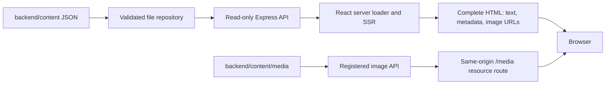

# Figma direction, regular Hebrew type and local content storage

Updated 2 November 2026. Local implementation only; production was not modified.

## Visual changes

The user-supplied `Modern Tour Company Website` export was inspected in source and rendered at 1440px and 390px in an isolated ignored preview. [Desktop reference](../.qa/figma-inspection/reference-1440.png), [mobile reference](../.qa/figma-inspection/reference-390.png), [computed reference styles](../.qa/figma-inspection/styles-1440.json). The original Figma export was left intact. Its Tailwind dependencies exist only in the isolated reference preview; the RoniElla application still uses native CSS and its existing dependency stack.

Adapted the export's dark forest masthead, full photographic hero with a directional gradient, gold contact buttons, staggered destination photography, dark philosophy section, warm gold testimonial band and dark footer. Retained Hebrew RTL, readable controls and the real business's content. The reference's fictional destinations, people, figures, form behavior and stock mountain imagery were not adopted.

**Regular text now uses locally hosted Assistant 400**, with 500/600 for labels and emphasis. This replaces Noto Sans Hebrew in the running interface. Frank Ruhl Libre remains the display family. Assistant gives the normal paragraphs and trip information a cleaner sans-serif appearance closer to the supplied reference's DM Sans, while supporting Hebrew. Local WOFF2 subsets, an OFL license and a provenance/hash record are in `frontend/public/assets/fonts/`. No runtime request to Google Fonts is needed. [Regular-weight comparison](../.qa/redesign/regular-font-comparison.png).

An explicit **דף הבית** link now appears in desktop navigation, the native mobile menu and internal-page breadcrumbs. The logo link also has an explicit Home accessibility label.

## Fresh live-site text import

The existing public discovery/extraction tools were run again against https://roniellatours.com/:

- 76 public HTML candidate requests, including aliases; 8 sitemap resources.
- 42 distinct source records: **40 available pages and 2 unavailable (404) records**. The full URL inventory accounts for 298 URLs, including excluded media/assets and external references.
- Imported 40 editable page JSON files: six separate tours, fifteen articles, guide biographies, information/legal pages and category/destination/author archives.
- Validation passed for 295 recorded relationships and five guide entities.
- Readable-text fidelity review passed on all 40 available pages, with **zero unmatched text snippets**.

The important content change was the April Uzbekistan trip: the live itinerary now has **nine days**, includes **Khiva**, and changes the city order and pricing text. The new files contain the freshly copied wording. Its overview highlights/route were updated accordingly. The original homepage card still describes the trip differently, so source verification notices remain; no conflicting facts were silently reconciled.

Two current public records returned 404 (the lead-status taxonomy and an unavailable China alias). They remain documented and are not replaced with invented page text. Image-only testimonial references are retained as evidence rather than fabricated transcriptions. Forms/scripts are not activated or copied into the renderer. Public text was read; no production mutations or private WordPress access occurred.

Fresh provenance and source snapshots: `docs/live-site-content/snapshots/2026-11-02-live-refresh/`; extracted source evidence: `docs/live-site-content/staging/2026-11-02-live-refresh/`. Runtime content lives separately in `rebuild/backend/content/`.

## Runtime architecture



The page is rendered **on the server for each request** before browser JavaScript runs. This is SSR rather than a client-only fetch or a new static-generation architecture. Keeping data and image files in the backend does not prevent SSR: the frontend server reads the content API, renders text/SEO and `` URLs into HTML, and streams registered photo responses through `/media/:filename`.

The application no longer depends on the research archive at startup or for its route build. `backend/content/index.json` is the public route registry; the backend reads page files, settings, presentation copy, redirects and photo metadata. All thirteen travel JPEGs (three originals and ten delivery variants) were moved out of frontend public. Metadata and source/license registries moved with them. UI icons and fonts remain frontend assets.

Only registered image filenames are served. JSON, source evidence, arbitrary paths and unregistered images return 404. Real-path boundary checks reject content files that escape their directory. The API remains read-only. `CONTENT_DIRECTORY` can select an isolated content folder; a test uses this to prove that the content store can change without rebuilding the frontend.

The `ContentRepository` interface and browser-safe schemas form the storage boundary for a later database implementation. The HTTP/SSR contract remains schema version 2; `contentSource: liveArchive` records the provenance of the imported public content. No Firebase SDK or database service was added.

## Editing and preview

Start with [backend/content/README.md](../backend/content/README.md), [presentation copy](../backend/content/presentation.json), [China tour](../backend/content/pages/tours-china-may-2027.json), [April tour](../backend/content/pages/tours-uzbekistan-april-2027.json) and [image metadata](../backend/content/media.json).

```powershell
cd D:\repos\RoniEllaToursWebsite\rebuild
npm.cmd run dev
```

Open http://127.0.0.1:5173/. Development watches JSON edits and restarts the API; refresh the browser. Existing-page text/metadata/media-assignment edits need no frontend build. A public path change also requires restarting/rebuilding the frontend. Production preview: `npm.cmd run build`, then `npm.cmd start`, open http://localhost:3000/.

The one-time `scripts/import-local-content.ts` importer accepts a reviewed crawl stage and refuses to overwrite an existing `index.json`. Later imports should go into a separate review directory with copied presentation/media metadata, then be reconciled with intentional local edits. Startup/build never re-crawl or overwrite content.

## Verification

Validation includes TypeScript, unit/repository tests, production build, HTTP/SEO checks, all-page browser checks, visitor journeys, the nine-day itinerary, keyboard/no-JavaScript behavior, responsive screenshots, font faces/weights, selected contrast checks and 200% text enlargement.

`npm.cmd run test:files` additionally edits two copies of the local JSON data, restarts only local test processes, and proves that both revisions appear in SSR text and metadata **without rebuilding the frontend or enabling browser JavaScript**. It also checks that photos load through the backend/resource route and that the explicit Home link works.

Final results:

| Check | Result |
| --- | --- |
| `npm.cmd run typecheck` | PASS — all workspaces and frontend route generation |
| `npm.cmd test` | PASS — 22 unit/repository/API tests |
| `npm.cmd run build` | PASS — shared/backend compilation and Vite client + SSR production build |
| `npm.cmd run smoke` | PASS — 40 public pages, full source tour/article text, metadata/canonicals, 72 one-hop redirects, 404 and backend-failure behavior |
| `npm.cmd run smoke:browser` | PASS — all 40 pages at desktop/mobile, hydration, navigation, refresh, focus, no overflow or browser/network errors |
| `npm.cmd run test:e2e` | PASS — full visitor journey, keyboard menu/itinerary, terms, articles, guide profiles and source fidelity |
| `npm.cmd run test:editorial` | PASS — 1440/768/390/320px, local Assistant/Frank Ruhl faces and weights, selected contrast, 200% text, keyboard, nine itinerary days, printing and no-JavaScript navigation |
| `npm.cmd run test:design` | PASS — 35 template/viewport combinations and regular-weight font specimen |
| `npm.cmd run test:files` | PASS — two edited content-folder copies, complete SSR text/metadata without a frontend rebuild/JS, backend photos and explicit Home navigation |
| Fresh archive validation + readable-text review | PASS — 40 available pages, zero unmatched readable snippets |

Reviewed captures: [homepage desktop](../.qa/redesign/home-1440.png), [full homepage](../.qa/redesign/home-1440-full.png), [mobile](../.qa/redesign/home-390.png), [tablet](../.qa/redesign/home-768.png), [article](../.qa/redesign/article-1440.png), [regular-weight comparison](../.qa/redesign/regular-font-comparison.png), [Hebrew font specimen](../.qa/editorial/type-specimen.png), [print PDF](../.qa/editorial/uzbekistan-print.pdf). The standalone type specimens use their own no-JavaScript browser page, separate from the app's hydration lifecycle. Local research/QA artifacts are Git-ignored and can be regenerated by the supplied scripts.

The browser suites provide selected accessibility coverage, not a formal accessibility audit or a target-audience user study.

## Files changed in this update

- `backend/content/`: new editable JSON content store, all forty page files, media metadata, moved photo assets, source map and editing guide.
- `backend/src/content-repository.ts`: file-backed runtime adapter and media registry.
- `backend/src/archive-repository.ts`: former archive reader retained for import/regression use, separate from runtime.
- `backend/src/app.ts`, `server.ts`, `backend/package.json`: registered-media endpoint, configurable content directory and development JSON watching.
- `shared/src/site-content.ts`: media/presentation contracts and local route-registry schema.
- `frontend/app/routes.ts`, `routes/media.ts`, `routes/content.tsx`: local route registry, same-origin image streaming and SSR content context.
- `frontend/app/components/site-content-context.tsx`, `travel-visuals.tsx`, `editorial-pages.tsx`, `editorial-config.ts`, `layout.tsx`: backend-driven media/copy, updated April overview and explicit Home navigation.
- `frontend/app/root.tsx`, `design.css`, `editorial.css`, `frontend/public/assets/fonts/`: Assistant fonts and Figma-informed presentation.
- `scripts/import-local-content.ts`, `assistant-fonts.mjs`, `figma-inspect.mjs`, `local-content-e2e.mjs`, `redesign-review.mjs`, `editorial-e2e.mjs`, `processes.mjs`, image helper scripts: import, reference inspection and regression tooling.
- `backend/tests/local-content.test.ts`, `repository.test.ts`, `package.json`, `README.md`, documentation: validation and operating instructions.
- `docs/live-site-content/`: new dated source snapshots, extraction stage and fidelity evidence; older archive evidence remains intact.
